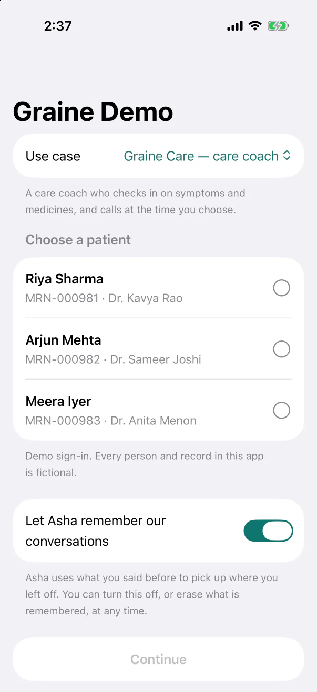
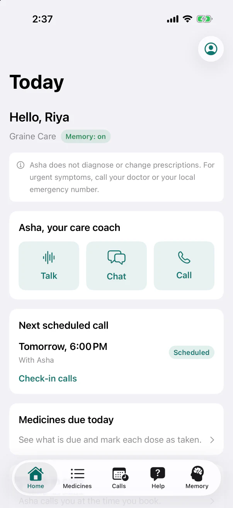
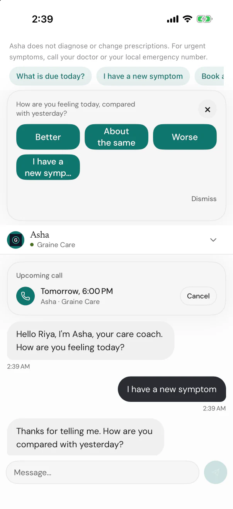
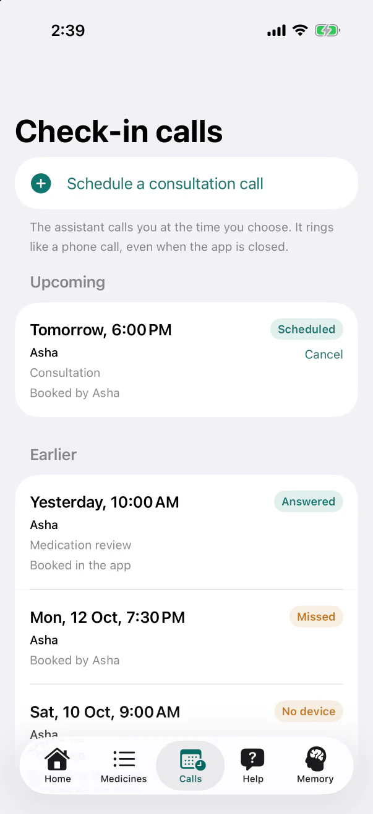
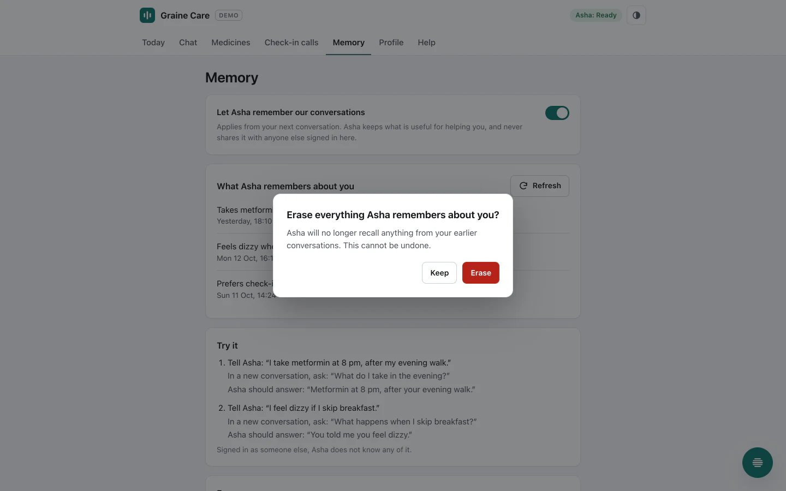

# Graine Demo

**Running it end to end — the dashboard, ringing, every platform, and a 10-minute demo script:
[RUN-THE-DEMO.md](RUN-THE-DEMO.md).**

One generic app, built for every platform the Graine in-app SDKs support, that shows everything they do:
an assistant that knows who the user is and remembers them (only with their consent), sees the screen
they are on and acts on it, chats with cards and lists, talks in a voice bar, takes a phone-style call,
and calls the user back at a time they book — ringing like a phone call even when the app is closed.

The app code contains no business domain. Every word that makes it a care coach, a banking assistant or a
shopping assistant comes from a **use-case pack** in [`usecases/`](usecases/README.md):

| Pack | App | Main agent (Home, Chat) | Help agent (Help screen) | Users identified by | List screen | Booking button |
|---|---|---|---|---|---|---|
| `health-coach` (default) | Graine Care | Asha, care coach | Billing & appointments help | `patient_id` | Medicines | Schedule a consultation call |
| `banking-support` | Graine Bank | Kabir, account assistant | Card security desk | `customer_id` | Cards | Request a callback |
| `retail-shopping` | Graine Store | Tara, shopping assistant | Returns desk | `shopper_id` | Orders | Book a delivery-update call |

Every app talks to **two agents**: the main agent on Home and Chat, and a help desk on the **Help** screen —
each its own agent with its own publishable key. The user signs in once; both agents know who they are, and
the Scheduled calls screen lists the calls booked with either, named.

All people, cards and orders are fictional.

<p>
  
  
  
  
</p>
<!-- SCREENSHOT: the SDK's booking sheet — day chips, the time, "Asia/Kolkata · Thu 15 Oct, 6:00 PM", "What's it about?" filled with the pack's reason (Android) -->


<sub>Taken with the offline demo (`scripts/offline-server.mjs`; for iOS see <a href="ios/README.md#offline-demo">ios/README.md</a>): no workspace and no key. More in <a href="docs/screenshots/">docs/screenshots</a>.</sub>

## What it shows

| Feature | React Native | Flutter | iOS | Android | Website | Kotlin Multiplatform |
|---|:-:|:-:|:-:|:-:|:-:|:-:|
| Three use cases, chosen on the sign-in screen and remembered | ✓ | ✓ ¹ | ✓ | ✓ | ✓ | ✓ ⁴ |
| Sign in as a fictional person, identified by the pack's field, with a memory consent switch | ✓ | ✓ | ✓ | ✓ | ✓ | ✓ |
| Memory on / off chip on Home | ✓ | ✓ | ✓ | ✓ | ✓ | ✓ |
| "What the assistant remembers about you" — list, pull to refresh, consent switch, erase with confirmation | ✓ | ✓ | ✓ | ✓ | ✓ | ✓ |
| Chat with components (check-in card, lists, time slots) | ✓ ² | ✓ | ✓ | ✓ | ✓ | ✓ |
| A conversation that continues: the chat reopens where the person left it (earlier messages under day lines, an earlier call as one row), with **New conversation** | ✓ ² | ✓ | ✓ | ✓ | ✓ | ✓ |
| Voice in the assistant bar | ✓ | ✓ | ✓ | ✓ | ✓ | ✓ |
| Screen context on every screen | ✓ | ✓ | ✓ | ✓ | ✓ | ✓ |
| App actions the assistant runs: open a screen, open an item, change an item's status | ✓ | ✓ | ✓ | ✓ | ✓ | ✓ |
| Call the assistant (a phone-style call) | ✓ | ✓ | ✓ | ✓ | — | ✓ |
| Book a call — the SDK's booking sheet (day, time, the time zone, an optional note) | ✓ | ✓ | ✓ | ✓ | ✓ | ✓ |
| Scheduled calls with status chips (scheduled, ringing, answered, completed, declined, missed, expired, no device) and Cancel | ✓ | ✓ | ✓ | ✓ | ✓ | ✓ |
| Hosted ringing — Graine rings the booked call | ✓ ³ | ✓ ³ | ✓ ³ | ✓ ³ | rings the user's phone app | ✓ ³ |
| Call outcomes logged in the app, with the agent each call was with | ✓ | ✓ | ✓ | ✓ | — | ✓ |
| Two agents in one app: a Help screen on a second agent (chat, voice, calls, booking), one sign-in for both, both agents' calls listed by name | ✓ ⁵ | ✓ ⁵ | ✓ | ✓ | ✓ | ✓ |

1. Flutter starts the chosen use case's two agents at launch: choosing a use case whose agents have other
   publishable keys takes effect the next time the app is opened (the app says so).
2. React Native draws the chat itself — in the Chat tab and under the Help screen's buttons — from the SDK's
   conversation state and components, laid out by the SDK's own rules: a conversation that continues shows its
   earlier messages under day lines and an earlier call as one "Voice call" row, and offers **New
   conversation**, as the SDK's chat windows do. An app that gives the chat a screen of its own can use the
   SDK's `GraineChatScreen`.
3. Real devices only (see [Testing hosted ringing](#testing-hosted-ringing)).
4. Kotlin Multiplatform: one Compose Multiplatform app in [`kmp/`](kmp/README.md) — Android 8.0+ and iOS 16+,
   every screen and SDK call in shared code, the SDK's own chat, call screen and voice bar as composables.
5. The help agent's key is optional: without it the Help screen says how to add one.

## What you need

- A Graine workspace with dashboard access.
- For the apps: a real iPhone and/or Android phone (calls and rings do not work in simulators).
- React Native: Node.js 18+, Xcode 16+ with CocoaPods, Android Studio with JDK 17.
- Flutter: Flutter 3.24+ (Dart 3.5+), plus Xcode and Android Studio as above.
- iOS: Xcode 16+ (iOS 16+). Android: Android Studio, JDK 17 (Android 8.0+). Website: any static server.
- For hosted ringing: an Apple Developer account (an APNs `.p8` key) and a Firebase project (a service-account
  JSON and the app's `google-services.json`).

## Set up

1. **Create the agent** for the use case you want — [`agent-setup/SETUP.md`](agent-setup/SETUP.md) walks
   through it in ten minutes from `agent-setup/<pack>/` (prompt, actions, components, settings). Two settings
   must match the pack exactly: **Memory → Who is the user? → Custom field** (`patient_id`, `customer_id` or
   `shopper_id`) and **Calls & scheduling → Users, from your app** (on).
2. **Allow the apps and the website**: Agent → Embed & Widgets → Allowed domains: `app://` for the apps,
   `localhost` for the website on your machine.
3. **Copy the publishable key** (`pk_live_…`, Agent → Embed & Widgets) into each app's configuration:

| App | Configuration (git-ignored) | Copy from |
|---|---|---|
| React Native | `react-native/.env` — `EXPO_PUBLIC_GRAINE_PUBLISHABLE_KEY` and `EXPO_PUBLIC_GRAINE_HELP_KEY`, or one key of each per pack | `react-native/.env.example` |
| Flutter | `flutter/dart_defines.json` — `GRAINE_PUBLISHABLE_KEY` and `GRAINE_HELP_KEY`, or one key of each per pack | `flutter/dart_defines.example.json` |
| iOS | `ios/Config.xcconfig` | `ios/Config.example.xcconfig` |
| Android | `android/local.properties` | `android/local.properties.example` |
| Website | `web/config.js` | `web/config.example.js` |

Each pack is two agents (main and help). One main key for all three packs works for a quick look; give each
pack its own keys to demo all three properly. The help key is optional.

## Run

**React Native** — an Expo development build (not Expo Go: the calls package carries native code):

```bash
cd react-native
npm install
npx expo run:ios --device          # or: npx expo run:android --device
npx expo start --dev-client        # later, to reload JavaScript only
npx tsc --noEmit && npx jest       # checks
```

**Flutter**:

```bash
cd flutter
flutter pub get
flutter run --dart-define-from-file=dart_defines.json
flutter analyze && flutter test    # checks
```

The Flutter app's `ios/Podfile` already enables the microphone and notification prompts and sets iOS 15.

**iOS** — open `ios/GraineDemo.xcodeproj`, run the **GraineDemo** scheme ([`ios/README.md`](ios/README.md)).

**Android** — `cd android && ./gradlew :app:installDebug` ([`android/README.md`](android/README.md)).

**Website** — from `demo/`: `npx serve .`, then open `http://localhost:3000/web/` ([`web/README.md`](web/README.md)).

### Where the SDKs come from

The committed manifests name the releases with the SDK's booking sheet: 0.10.1, React Native 0.44.1 and calls
0.3.0. Until a registry has its version, build that app against the SDK's sources with its local-SDK switch —
the sources of iOS, Android, Flutter and Kotlin Multiplatform are public repositories, tagged with each
release:

| App | Committed dependency | Registry | Live today | Until it is |
|---|---|---|:-:|---|
| iOS | `GraineInApp` from `https://github.com/GraineAI/inapp-ios`, from 0.10.1 | Swift Package Manager | yes | `ios/use-local-sdk.sh` → a checkout of `https://github.com/GraineAI/inapp-ios` ([`ios/README.md`](ios/README.md)) |
| Android | `ai.graine:inapp-android:0.10.1` | Maven Central | yes | `graine.sdkDir` → a checkout of `https://github.com/GraineAI/inapp-android` ([`android/README.md`](android/README.md)) |
| Kotlin Multiplatform | `ai.graine:inapp-kmp` and `inapp-kmp-compose` 0.10.1 (+ `inapp-android-rtc`); iOS: `GraineInApp` and `GraineInAppRTC` (Swift Package Manager) | Maven Central | yes | `graine.kmpSdkDir` → a checkout of `https://github.com/GraineAI/inapp-kmp`, with `inapp-android` beside it ([`kmp/README.md`](kmp/README.md)) |
| Flutter | `graine_inapp: ^0.10.1` | pub.dev | yes | `scripts/use-local-sdks.sh local flutter` → a checkout of `https://github.com/GraineAI/inapp-flutter` |
| React Native | `@graineai/inapp-react-native` ^0.44.1, `@graineai/inapp-react-native-calls` ^0.5.1 | npm | yes | `scripts/use-local-sdks.sh local rn` → the React Native SDK's sources (below) |
| Website | the loader, `https://www.graine.ai/embed/v1.js` | — | **yes** | — |

The SDK's CocoaPods pod (`GraineInApp`) is not on trunk yet either; these demos do not use it.

Flutter and React Native switch with one script, from the repository root:

```bash
git clone --branch 0.10.1 https://github.com/GraineAI/inapp-flutter ../inapp-flutter
scripts/use-local-sdks.sh local flutter    # flutter/pubspec_overrides.yaml → ../inapp-flutter
GRAINE_SDK_RN_DIR=/path/to/sdk scripts/use-local-sdks.sh local rn
                                          # the folder holding the React Native SDK's inapp/ and inapp-calls/
scripts/use-local-sdks.sh published       # back to the published versions, before you commit
node scripts/check-manifests.mjs          # fails while a manifest still points at local sources
```

Then `flutter pub get` in `flutter/` and `npm install` in `react-native/`. `GRAINE_SDK_FLUTTER_DIR` points the
Flutter switch at another checkout. iOS has its own switch for an SDK that is not tagged yet
(`ios/use-local-sdk.sh`); Android and Kotlin Multiplatform switch in their `local.properties`.

## Testing hosted ringing

A booked call is rung by Graine with a VoIP push (iOS) or a high-priority FCM message (Android). This only
works on **real devices**, with the app installed from your own build:

1. **Workspace settings → In-app calling**: upload your APNs key for the iOS bundle ID you build (React Native
   default `ai.graine.demo.rn`, Flutter `ai.graine.demo.flutter`; environment *Sandbox* for development builds)
   and your Firebase service-account JSON for the Android package. Wait until each shows **verified**.
2. **Android**: put your Firebase `google-services.json` in `react-native/` (or set
   `GRAINE_DEMO_GOOGLE_SERVICES_FILE`) and in `flutter/android/app/`, then rebuild. That is all: the apps
   have no messaging service of their own — the SDK registers for pushes itself (its own messaging service
   receives the push token and the call pushes, natively). React Native gets Firebase Cloud Messaging from
   the calls package's Expo plugin (calls 0.5.1+, listed in `app.config.ts`); Flutter declares it in
   `flutter/android/app/build.gradle.kts`. An app that already has a Firebase messaging service forwards
   from that one instead (`handlePush` and the push token, as the SDK's docs show).
3. On the phone, sign in (allow the microphone and, on Android 13+, notifications), open **Calls →
   Schedule a consultation call**: the SDK's booking sheet opens, its "What's it about?" already filled with
   the pack's reason. Pick today and a time a few minutes ahead, tap **Book call**, then **Done**. The call
   appears as **Scheduled** with **Cancel**.
4. Lock the phone or close the app. At the booked time it rings like a phone call, named as set under Calls &
   scheduling (for example "Asha · Graine Care"). Answer: the assistant opens with the booking's reason.
5. Back in the app, the call moves to **Answered**, then **Completed**; *Call activity on this phone* lists the
   ring and its outcome. Book again and decline → **Declined**; let it ring out → **Missed** (and one re-ring
   if set).
6. Book a call, then sign out before it is due → **No device** (signing out releases the phone).

## QA checklist

- [ ] The sign-in screen offers three use cases; switching changes the people, the agent's name, the list
      screen and the booking button.
- [ ] Sign in with memory on → Home shows **Memory on**. Turn the switch off on the Memory screen → **Memory off**.
- [ ] **Talk to Asha** opens the voice bar and the assistant greets the user by name; ending closes it.
- [ ] **Chat**: the assistant shows a component (for example the daily check-in); a tap answers it.
- [ ] A conversation continues: close the app in the middle of a chat and open it again — the chat shows the
      earlier messages under a day line (an earlier call as one "Voice call" row) and no starters; **New
      conversation** in the chat's header starts a fresh one, and what the assistant remembers stays.
- [ ] Screen context: on the list screen, ask "what is due today?" — the assistant answers from the screen.
- [ ] Actions: "open my medicines" navigates; "I have taken my metformin" marks it **Taken today**; asking
      again says it is already done; another person's item is refused.
- [ ] **Call Asha** places a phone-style call; the assistant knows the user called.
- [ ] Booking: the pack's booking button opens the SDK's booking sheet in the agent's design — day chips,
      the time in 5-minute steps inside what the agent allows, the time zone, "What's it about?" filled with
      the pack's reason; **Book call** → "Booked — …" → **Done**; the call appears with **Scheduled** and
      **Cancel**; Cancel → **Cancelled**.
- [ ] With Calls & scheduling → **Users, from your app** off, the booking button stays on screen, disabled,
      with "Booking needs, in Graine UI: users may book (Calls & scheduling), this app's push keys (Workspace settings → In-app calling), and Who is the user? set to this pack's ID."
- [ ] A refused booking is explained in the sheet, in one line under **Book call** (for example a time outside
      the agent's calling hours).
- [ ] Hosted ringing, as above.
- [ ] Two agents: **Help** opens the help agent (for example *Billing & appointments help*) — it already
      knows who the user is (no second sign-in); its chat and voice are its own; opening Help ends the main
      agent's voice and chat. Book a call from Help (its own sheet, starting with the help agent's reason) →
      it appears under Scheduled calls named after the help agent, next to the main agent's calls; Cancel
      works on either. *Call activity*
      names the agent of every ring and outcome.
- [ ] Memory never crosses people — the script below.

### Memory QA script

What is said is remembered when a conversation ends, so end each conversation before the next step: close the
app completely, or sign out and back in. A person who comes back finds their conversation where they left it,
so to show what **memory** knows — not the conversation — tap **New conversation** in the chat's header before
asking: the chat starts fresh, and memory stays. Each pack has its own sentences (`memoryExamples` in its file):

| Pack | Tell | Then ask | Expect |
|---|---|---|---|
| Care coach | "I take metformin at 8 pm, after my evening walk." | "What do I take in the evening?" | Metformin at 8 pm |
| Banking | "I travel to Singapore every March for work." | "When do I usually travel abroad?" | Every March, to Singapore |
| Shopping | "I wear size 7 in running shoes." | "What size do I wear in running shoes?" | Size 7 |

1. Sign in as the first person (memory on). In **Chat**, tell the assistant the sentence. End the conversation.
2. Open the app again: the chat continues where it was. Tap **New conversation**, then ask the question — the
   assistant knows.
3. Open **Memory**: the list shows it (pull to refresh). The dashboard shows it too: Agent → Memory → People.
4. Sign out, sign in as the second person, ask the same question — the assistant does not know, and their
   Memory list does not show it.
5. Sign out, sign in as the first person again, tap **New conversation** and ask — the assistant knows again.
6. **Erase everything** → confirm → the list is empty; in a new conversation the assistant no longer knows.
7. Turn memory off, tell it something new, end the conversation — in a new conversation it does not know it.

## Troubleshooting

- **"The app's publishable key was refused"** — Allowed domains lacks `app://` (apps) or `localhost` (website),
  or the key belongs to another agent.
- **Memory stays empty** — Memory is off for the agent, *Who is the user?* is not the pack's field, the user
  turned memory off, or the user is already on two other devices (Devices per user).
- **The booking button is disabled (the line under it says what to set)** — Calls & scheduling → Users,
  from your app is off, the workspace has no in-app calling for this platform (Workspace settings → In-app
  calling), or the person is not identified with the pack's field (**Who is the user?**).
- **A booked call never rings** — In-app calling is not verified for this bundle ID or package, the phone is a
  simulator, or (Android) the build has no `google-services.json`.
- **Flutter keeps the previous use case** — that pack's agents have other keys; close and reopen the app.
- **The Help screen asks for a key** — add the help agent's publishable key (see Set up), created from
  `agent-setup/<pack>/help-settings.md`.

## In this repository

| Folder | What |
|---|---|
| [`usecases/`](usecases/README.md) | The three use-case packs and their JSON Schema — shared by every platform |
| [`agent-setup/`](agent-setup/SETUP.md) | Recreate each pack's agent: prompt, actions, components, settings |
| `react-native/` | Expo development build (TypeScript); every SDK call in `src/graine.ts` |
| `flutter/` | Flutter app; every SDK call in `lib/graine_service.dart` |
| `ios/` | SwiftUI app |
| `android/` | Kotlin app |
| `web/` | The website |
| `scripts/` | Pack and kit checker (`check-usecases.mjs`), agent actions generator, SDK source switch |
